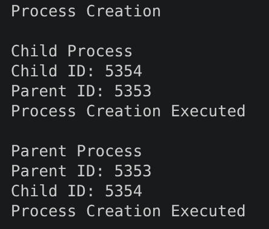

# Process Creation

## Overview
This program demonstrates **Process Creation** in C using the `fork()` system call in a Unix/Linux operating system. It creates a child process from the parent process and displays their respective Process IDs (PID).

## Objectives
- Understand process creation using `fork()`.
- Identify parent and child processes.
- Retrieve process IDs using `getpid()` and `getppid()`.
- Understand process synchronization using `wait()`.

## Source Code
**File:** `process_creation.c`

```c
#include<stdio.h>
#include<unistd.h>
#include<sys/types.h>
#include<sys/wait.h>

int main()
{
    printf("Process Creation\n\n");
    pid_t pid=fork();
    if(pid<0)
        printf("Process Creation Failed\n");
    else if(pid==0)
    {
        printf("Child Process\n");
        printf("Child ID: %d\n", getpid());
        printf("Parent ID: %d\n", getppid());
    }
    else
    {
        wait(NULL);
        printf("Parent Process\n");
        printf("Parent ID: %d\n", getpid());
        printf("Child ID: %d\n", pid());
    }
    printf("Process Creation Executed\n\n");
    return 0;
}
```

## Functions Used

| Function | Description |
|---|---|
| `fork()` | Creates a new child process. |
| `getpid()` | Returns the current process ID. |
| `getppid()` | Returns the parent process ID. |
| `wait(NULL)` | Makes the parent process wait until the child process terminates. |

## Compilation and Execution

**1. Compile the program:**

```bash
gcc process_creation.c -o process_creation
```

**2. Run the program:**

```bash
./process_creation
```

## Sample Output

<p align="center">
  
</p>

*Note: Process IDs may vary depending on the system.*

## Requirements
- Linux or Unix-based operating system
- GCC compiler
- C programming language

## Key Concepts
- Process Creation
- Parent and Child Processes
- Process Identification (PID)
- Process Synchronization

## Author
Nitun Krishna Biswas

**Language:** C  
**Platform:** Ubuntu / Linux  
**Category:** Operating System Lab
