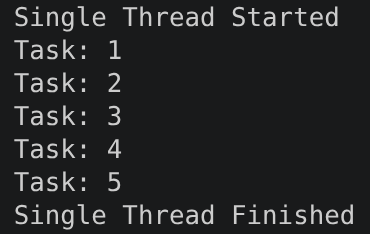

# Single Thread Execution

## Overview

This program demonstrates **Single Thread Execution** using the C programming language.

It executes a task sequentially within a single thread. The program prints numbers from 1 to 5 using a function called `task()`.

## Objectives

- Understand the concept of single-thread execution.
- Learn sequential execution of instructions.
- Understand function calling within a single thread.
- Observe the execution flow of a C program.

## Source Code

**File:** `single_thread.c`

```c
#include<stdio.h>

void task()
{
    for(int i=1; i<=5; i++)
    {
        printf("Task: %d\n", i);
    }
}

int main()
{
    printf("Single Thread Started\n");
    task();
    printf("Single Thread Finished\n");
    return 0;
}
```

## Output

The following image shows the output of the program.

\<p align="center">
&#x20; \
\</p>

## Compilation and Execution

**1. Compile the program:**

```bash
gcc single_thread.c -o single_thread
```

**2. Run the program:**

```bash
./single_thread
```

## Requirements

- Linux or Unix-based operating system
- GCC compiler
- C programming language

## Key Concepts

- Single Thread Execution
- Sequential Execution
- Function Calling
- Looping

## Conclusion

The program successfully demonstrates single-thread execution. All instructions are executed sequentially within a single thread without creating any additional threads.

## Author

Nitun Krishna Biswas

**Language:** C
**Platform:** Ubuntu / Linux
**Category:** Operating System Lab
