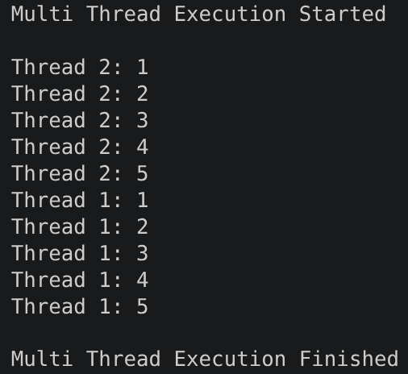

# Multithread Execution

## Overview

This program demonstrates **Multithread Execution** using the POSIX Threads (Pthreads) library in C.

It creates two independent worker threads. Each thread executes a separate task and prints numbers from 1 to 5. Both threads can execute concurrently within the same process.

## Objectives

- Understand the concept of multithreading.
- Learn how to create multiple threads using `pthread_create()`.
- Understand thread synchronization using `pthread_join()`.
- Observe concurrent execution of multiple threads.
- Learn the use of Pthread library functions.

## Source Code

**File:** `multi_thread.c`

```c
#include<stdio.h>
#include<pthread.h>

void* task1(void* arg)
{
    for(int i=1; i<=5; i++)
    {
        printf("Thread 1: %d\n", i);
    }
    return NULL;
}

void* task2(void* arg)
{
    for(int i=1; i<=5; i++)
    {
        printf("Thread 2: %d\n", i);
    }
    return NULL;
}

int main()
{
    pthread_t thread1, thread2;

    printf("Multi Thread Execution Started\n\n");

    pthread_create(&thread1, NULL, task1, NULL);
    pthread_create(&thread2, NULL, task2, NULL);

    pthread_join(thread1, NULL);
    pthread_join(thread2, NULL);

    printf("\nMulti Thread Execution Finished\n");

    return 0;
}
```

## Functions Used

| Function | Description |
|---|---|
| `pthread_create()` | Creates a new thread. |
| `pthread_join()` | Waits for a specific thread to finish execution. |
| `printf()` | Displays output on the screen. |
| `task1()` | Defines the task for Thread 1. |
| `task2()` | Defines the task for Thread 2. |

## Parameters of pthread_create()

The `pthread_create()` function is used to create a new thread.

**Syntax:**

```c
pthread_create(&thread, NULL, taskFunction, NULL);
```

It accepts four parameters:

| Parameter | Description |
|---|---|
| `&thread` | Stores the identifier of the newly created thread. |
| `NULL` | Uses the default thread attributes. |
| `taskFunction` | Specifies the function that the new thread will execute. |
| `NULL` | Passes no argument to the thread function. |

**Usage in this program:**

```c
pthread_create(&thread1, NULL, task1, NULL);
pthread_create(&thread2, NULL, task2, NULL);
```

- The first statement creates Thread 1 and executes `task1()`.
- The second statement creates Thread 2 and executes `task2()`.

## Parameters of pthread_join()

The `pthread_join()` function waits for a specific thread to terminate.

**Syntax:**

```c
pthread_join(thread, NULL);
```

| Parameter | Description |
|---|---|
| `thread` | Specifies which thread to wait for. |
| `NULL` | Does not retrieve the thread's return value. |

**Usage in this program:**

```c
pthread_join(thread1, NULL);
pthread_join(thread2, NULL);
```

The main thread waits until both worker threads finish their execution.

## Output

The following image shows the output of the program.

<p align="center">
  
</p>

*Note: The execution order of the two threads may vary each time the program runs because the CPU scheduler determines their execution.*

## Compilation and Execution

**1. Compile the program:**

```bash
gcc multi_thread.c -o multi_thread -pthread
```

**2. Run the program:**

```bash
./multi_thread
```

## Requirements

- Linux or Unix-based operating system
- GCC compiler
- POSIX Threads (Pthreads) library
- C programming language

## Key Concepts

- Multithreading
- Concurrent Execution
- Thread Creation
- Thread Synchronization
- Pthread Library

## Conclusion

The program successfully demonstrates multithread execution using the Pthreads library. Two worker threads are created, and each executes its own task concurrently. The `pthread_join()` function ensures that the main thread waits for both worker threads to complete their execution.

## Author

Nitun Krishna Biswas

**Language:** C  
**Platform:** Ubuntu / Linux  
**Category:** Operating System Lab